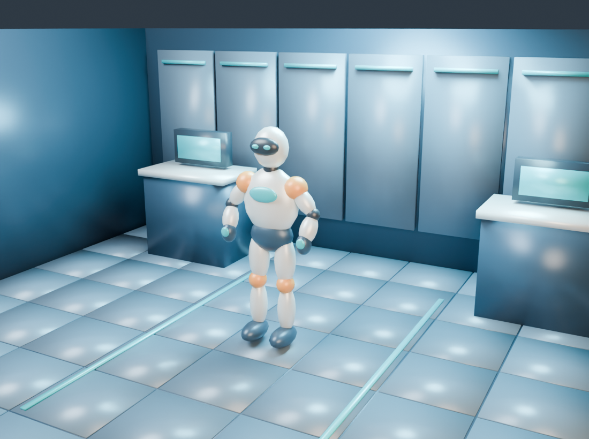

# Isaac Sim VR 实验室

`lab.usda` 是 Isaac Sim 与 Blender 共用的场景文件，包含实验室、地板碰撞、实验台和一个程序化人形化身。化身由可独立驱动的头部、双手和手臂组成。躯干和腿保持站姿，双臂通过两段逆运动学跟随手柄位置。



## 在 Isaac Sim 中运行

在具备兼容 NVIDIA RTX GPU 的机器上安装 Isaac Sim 5.x。从仓库根目录执行，按实际安装位置替换 `/path/to/isaac-sim`。

```bash
/path/to/isaac-sim/python.sh vr_lab/run_isaac.py
```

也可以在 Isaac Sim 的界面中打开 `vr_lab/lab.usda` 查看静态场景。需要验证独立启动时，可给脚本传入 `--headless --frames 60`。

## 用 Blender 渲染

在仓库根目录用支持 USD 导入的 Blender 4.3 执行。脚本导入同一份 USD，并设置摄影机、灯光和 Cycles CPU 渲染。

```bash
blender -b --python-exit-code 1 --python vr_lab/render_blender.py
```

默认输出到 `vr_lab/renders/lab.png`。可在 `--` 后添加 `--output /path/to/lab.png`，或用 `--samples 8 --scale 50` 生成快速预览。

修改模型后，用 Python 3.12 虚拟环境重建场景。

```bash
python3.12 -m venv .venv
.venv/bin/python -m pip install usd-core==25.11
.venv/bin/python vr_lab/build_scene.py
```

## 测试姿态控制

启动 Isaac Sim 脚本后，从仓库根目录发送一帧样例数据。化身会转头并抬起双手。

```bash
python3 - <<'PY'
from pathlib import Path
import socket

with socket.socket(socket.AF_INET, socket.SOCK_DGRAM) as sender:
    sender.sendto(Path("vr_lab/example_pose.json").read_bytes(), ("127.0.0.1", 8765))
PY
```

每个 UDP 数据报是一个 UTF-8 JSON 对象，包含 `head`、`left` 和 `right` 三个目标。每个目标包含以米为单位的 `position`（三个值）和 `orientation_xyzw`（四元数）。以化身根节点为原点，默认朝向 −Y，+Z 向上，−X 为化身右侧。接收端只监听本机，可用 `--port` 修改端口。手柄超出手臂长度时，手的位置会限制在可达范围内。

接入 VR 设备时，可在运行 Isaac Sim 的机器上增加一个 OpenXR 适配器，以头显视图位姿和左右手 grip 位姿作为输入，校准原点与朝向，再按此格式持续发送。对于默认 −Z 前方、+Y 向上的 OpenXR 坐标，可把位置向量映射为 `(−x, z, y)`，朝向用同一个坐标基变换 `R_lab = M R_xr M⁻¹` 后再转为四元数。桥接侧应在运行时统一应用位置和旋转变换，并做设备朝向校准。当前示例提供本机姿态接收端和样例数据。OpenXR 设备读取、头显内画面输出及全身跟踪需要后续实现。
